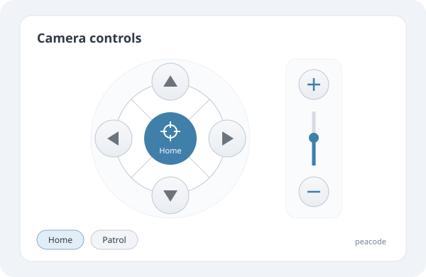

# PTZ Control Card

Pan, tilt, zoom and preset controls for Home Assistant dashboards — or a reusable
four-way control pad for script-driven devices.

[Deutsch](docs/README.de.md) · [Configuration reference](docs/configuration.md) · [Releases](https://github.com/peacodecom/ptz-control-card/releases) · [Report an issue](https://github.com/peacodecom/ptz-control-card/issues)

- **Author and maintainer:** [Norman Bauer](https://github.com/norman-bauer)
- **Publisher:** [peacode](https://peacode.com), a registered trademark
- **License:** [MIT](LICENSE)



_Layout illustration; icons and appearance depend on your theme and configuration._

## Features

- Circular directional controls with hold-to-move or single-press mode.
- Best-effort automatic stop on release, pointer cancellation, focus loss,
  hidden browser tab, reconfiguration and card removal; delayed second stop.
- Optional preset buttons and a center button for stop or preset recall.
- Optional zoom slider and buttons, absolute or percentage-based increments.
- Buttons and scripts; select/number entities and corresponding helpers.
- Configurable icons and colors, responsive layout and keyboard controls.
- No runtime dependencies, cloud account, telemetry or camera credentials.

This is a **dashboard card**, not a camera integration. It uses entities already
provided by your camera integration or scripts. It does not display video or
provide ONVIF connectivity. An existing `custom:ptz-control-card` YAML configuration
can be reused when it uses the documented entity domains.

## Installation

Back up your existing configuration first. The repository must be public and a
release with the JavaScript asset must be available before installing it by link.

### Marketplace: Home Assistant 2026.11 and later

Starting with Home Assistant 2026.11, HACS is built in as the **Marketplace**.
Do not additionally install the old HACS custom integration on these versions.

1. As an administrator, open **Settings → Marketplace** and accept the
   community-content warning if prompted.
2. Select **Add from link** in the upper-right corner. Connect your GitHub account
   if requested; a GitHub connection is required for custom repositories.
3. Under **GitHub link**, enter `https://github.com/peacodecom/ptz-control-card`
   and select **Add**.
4. If asked for **Type**, choose **Dashboard**, then select **Add** again.
5. Open **PTZ Control Card**, choose **Install**, review the version and confirm.
6. The Marketplace normally registers the dashboard resource automatically.
   If you manage resources in YAML, add the resource shown in the install dialog
   under `lovelace.resources` as a JavaScript module. Its path is
   `/local/community/ptz-control-card/ptz-control-card.js`.
7. Reload your browser and add a manual card using one of the examples below.

The new resource prefix is `/local/community/`; existing `/hacsfiles/` paths remain
compatible when migrating from HACS. Do not register both copies.

See the official [Marketplace instructions](https://www.home-assistant.io/integrations/marketplace/#custom-repositories).

### HACS: Home Assistant 2026.10 and earlier

The repository is intended for installation as a **Dashboard** custom repository
(HACS category `plugin`); default-store inclusion is not implied.

1. Open HACS, open the three-dot menu, then **Custom repositories**.
2. Add `https://github.com/peacodecom/ptz-control-card`, category **Dashboard**.
3. Download **PTZ Control Card** after a release has been published.
4. Check **Settings → Dashboards → Resources**. If the resource was not registered
   automatically, add `/hacsfiles/ptz-control-card/ptz-control-card.js` as a
   **JavaScript module**. Enable Advanced Mode in your profile if Resources is hidden.
5. Reload the browser and add a manual card using the example below.

### Manual installation

1. Download `ptz-control-card.js` from a GitHub release, **not** from `src/`.
2. Copy it into Home Assistant's `config/www/` directory.
3. Add `/local/ptz-control-card.js?v=0.1.0` as a **JavaScript module** dashboard
   resource (or under `lovelace.resources` in YAML mode).
4. Reload the browser. Change the query-string version after an update if needed.

Do not load manual and Marketplace/HACS copies together. Back up the existing file before
replacing a previous local version. Node.js is only required for development,
not for installation.

## Quick start

Use the actual entity IDs from **Settings → Devices & services → Entities**:

```yaml
type: custom:ptz-control-card
title: Camera controls
ptz_left: button.camera_ptz_left
ptz_up: button.camera_ptz_up
ptz_right: button.camera_ptz_right
ptz_down: button.camera_ptz_down
ptz_stop: button.camera_ptz_stop
```

With zoom and presets:

```yaml
type: custom:ptz-control-card
title: Camera controls
ptz_left: button.camera_ptz_left
ptz_up: button.camera_ptz_up
ptz_right: button.camera_ptz_right
ptz_down: button.camera_ptz_down
ptz_stop: button.camera_ptz_stop
zoom_entity: number.camera_zoom
zoom_button_step_percent: 10
preset_entity: select.camera_preset
center_preset: Home
# Only needed if selecting a preset does not move the camera:
preset_go_entity: button.camera_go_to_preset
```

`Home` must exactly match an option of your select entity. Preset buttons select
an option; only the center button additionally calls `preset_go_entity`.

For momentary controls that do not need a stop command, set `hold_mode: false`
and `show_center: false`, then omit `ptz_stop`.

## Beyond cameras: heating-panel navigation

The four direction buttons can also trigger scripts that emulate the physical
up/down/left/right keys of a heating controller. Each click starts one script;
there is no hold-to-move behavior or stop action in this setup.

```yaml
type: custom:ptz-control-card
title: Heating panel
ptz_left: script.heating_panel_left
ptz_up: script.heating_panel_up
ptz_right: script.heating_panel_right
ptz_down: script.heating_panel_down
hold_mode: false
show_center: false
show_zoom: false
show_preset: false
icon_up: mdi:arrow-up-bold
icon_right: mdi:arrow-right-bold
icon_down: mdi:arrow-down-bold
icon_left: mdi:arrow-left-bold
```

These are illustrative entity IDs. Create the corresponding scripts yourself;
the card does not discover or configure relays. Each script must safely complete
its own bounded key press and release. This is a navigation pad, not a thermostat
or heating safety controller. A separate camera card can optionally show the
physical panel's display; video is not part of this card.

The [standalone YAML example](docs/examples/heating-panel.yaml) is ready to adapt.

## Options at a glance

| Option | Default | What it does |
| --- | --- | --- |
| `ptz_left`, `ptz_up`, `ptz_right`, `ptz_down` | required | Entity triggered for each direction: button, input button or script. |
| `title` | `PTZ Control` | Card heading. |
| `hold_mode` | `true` | Hold to move and release to stop; `false` triggers one action per click. |
| `ptz_stop` | conditional | Stop entity; required for hold mode or a visible stop center button. |
| `show_center` | `true` | Show the center button for stop or preset recall. |
| `preset_entity` | none | Select/input-select entity providing preset choices. |
| `show_preset` | `true` | Show preset selection buttons. |
| `center_preset` | selected preset | Preset recalled by the center button. |
| `preset_go_entity` | none | Optional action after successful center-button preset selection. |
| `zoom_entity` | none | Number/input-number entity controlled by the zoom UI. |
| `show_zoom` | `true` | Show zoom controls if a zoom entity is configured. |
| `zoom_button_step` | `10` | Absolute zoom-button increment. |
| `zoom_button_step_percent` | none | Percentage of the zoom range; overrides the absolute increment. |
| `icon_*`, `text_center` | automatic | Customize direction/center icons and center text. |
| `color_*` | gray/blue design | Customize ring, buttons, presets and zoom colors. |

The [complete configuration tables](docs/configuration.md) list every supported
option, its default and its effect, including individual icons and color settings.

## Safety and limitations

Stop commands are **best effort**, not a safety mechanism. A closed browser,
network outage, disconnected device or unavailable stop entity can prevent a stop.
Configure camera-side motion timeouts or bounded movement scripts where possible.
Use only with hardware whose movement can be operated safely.

- Movement is disabled in hold mode when the stop entity is unavailable.
- Scripts must implement the desired movement/stop semantics themselves.
- Preset/zoom values and limits come from the underlying entities.
- No graphical configuration editor; configure the card in YAML.
- Current evergreen browsers supporting ES2022 and Pointer Events are required.
- Automated DOM tests do not replace real-camera, touch-device and browser tests.

## Development and support

See [CONTRIBUTING.md](CONTRIBUTING.md), [release instructions](docs/releasing.md)
and [security policy](SECURITY.md). The [validation record](docs/validation.md)
distinguishes automated checks from pending hardware and installation tests.
For bugs, provide the card version, Home
Assistant version, browser and a minimal, sanitized configuration.

Copyright © 2026 Norman Bauer. Published by peacode.
See [AUTHORS.md](AUTHORS.md) for ownership and trademark information.