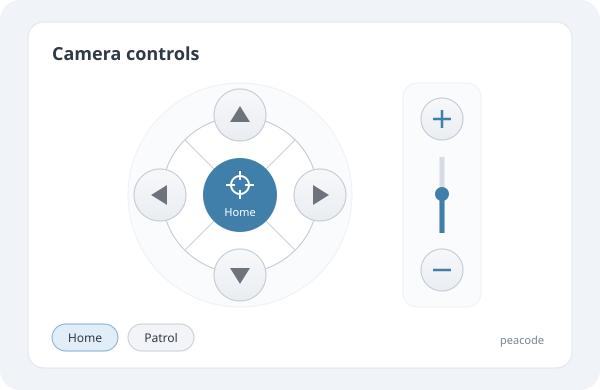

# PTZ Control Card

Schwenken, Neigen, Zoom und Presets für Home-Assistant-Dashboards – oder ein
wiederverwendbares Vier-Wege-Bedienfeld für Geräte mit Script-Steuerung.

[English](../README.md) · [Vollständige Konfiguration](configuration.de.md)

- **Autor und Maintainer:** [Norman Bauer](https://github.com/norman-bauer)
- **Publisher:** [peacode](https://peacode.com), eine eingetragene Marke
- **Lizenz:** [MIT](../LICENSE)



_Layout-Illustration; Icons und Darstellung hängen von Theme und Konfiguration ab._

## Funktionen

- Kreisförmige Richtungstasten: gedrückt halten oder einzeln auslösen.
- Stopversuch beim Loslassen, Abbrechen der Berührung, Fokusverlust, Ausblenden
  des Browser-Tabs, Neukonfiguration und Entfernen der Karte; zweiter Stopversuch.
- Optionale Preset-Tasten und Mitteltaste für Stop oder Preset-Aufruf.
- Optionaler Zoomregler mit absoluten oder prozentualen Schritten.
- Unterstützung für Buttons, Scripts, Selects, Numbers und entsprechende Helfer.
- Anpassbare Icons und Farben, responsives Layout und Tastaturbedienung.
- Keine Laufzeitabhängigkeiten, Telemetrie oder Kamera-Zugangsdaten.

Dies ist eine **Dashboard-Karte**, keine Kamera-Integration. Sie verwendet bereits
vorhandene Entitäten oder Scripts. Videobild und ONVIF-Anbindung gehören nicht zum
Funktionsumfang. Vorhandenes YAML für `custom:ptz-control-card` kann mit den
dokumentierten Entitätsdomänen weiterverwendet werden.

## Installation

Zuerst die vorhandene Konfiguration sichern. Für die Installation per Link muss
das Repository öffentlich und ein Release mit JavaScript-Datei verfügbar sein.

### Marketplace: Home Assistant ab 2026.11

Ab Home Assistant 2026.11 ist HACS als **Marketplace** eingebaut.
Die bisherige HACS-Custom-Integration dort nicht zusätzlich installieren.

1. Als Administrator **Einstellungen → Marketplace** öffnen und gegebenenfalls
   den Hinweis zu Community-Inhalten bestätigen.
2. Oben rechts **Add from link** (Hinzufügen über einen Link) wählen. Falls
   angefordert, das GitHub-Konto verbinden; für eigene Repositories ist das nötig.
3. Unter **GitHub link** `https://github.com/peacodecom/ptz-control-card` eintragen
   und **Add** wählen.
4. Falls nach **Type** gefragt wird, **Dashboard** auswählen und erneut **Add**
   bestätigen. Die Bezeichnungen können je nach Sprache abweichen.
5. **PTZ Control Card** öffnen, **Install** wählen, Version prüfen und bestätigen.
6. Der Marketplace registriert die Dashboard-Ressource normalerweise automatisch.
   Bei YAML-verwalteten Ressourcen die im Installationsdialog angezeigte Ressource
   unter `lovelace.resources` als JavaScript-Modul ergänzen. Der Pfad lautet
   `/local/community/ptz-control-card/ptz-control-card.js`.
7. Browser neu laden und eine manuelle Karte mit einem der folgenden Beispiele anlegen.

Der neue Ressourcenpräfix ist `/local/community/`. Bisherige `/hacsfiles/`-Pfade
funktionieren beim Umstieg von HACS weiter. Nicht beide Varianten registrieren.

Offizielle [Marketplace-Anleitung](https://www.home-assistant.io/integrations/marketplace/#custom-repositories).

### HACS: Home Assistant bis einschließlich 2026.10

Das Repository wird als benutzerdefiniertes **Dashboard**-Repository installiert
(HACS-Kategorie `plugin`). Eine Aufnahme in den Standardkatalog wird nicht behauptet.

1. In HACS das Drei-Punkte-Menü → **Benutzerdefinierte Repositories** öffnen.
2. `https://github.com/peacodecom/ptz-control-card` mit Kategorie **Dashboard** hinzufügen.
3. **PTZ Control Card** nach Veröffentlichung eines Releases herunterladen.
4. Unter **Einstellungen → Dashboards → Ressourcen** prüfen, ob die Ressource
   vorhanden ist. Falls nötig, `/hacsfiles/ptz-control-card/ptz-control-card.js`
   als **JavaScript-Modul** eintragen. Gegebenenfalls den erweiterten Modus im Profil aktivieren.
5. Browser neu laden und eine manuelle Karte hinzufügen.

### Manuelle Installation

1. `ptz-control-card.js` aus einem GitHub-Release herunterladen, nicht aus `src/`.
2. In den Home-Assistant-Ordner `config/www/` kopieren.
3. `/local/ptz-control-card.js?v=0.1.1` als **JavaScript-Modul** in den
   Dashboard-Ressourcen eintragen; bei YAML-Verwaltung unter `lovelace.resources`.
4. Browser neu laden; bei Updates gegebenenfalls die Versionskennung ändern.

Nicht gleichzeitig die manuelle und die Marketplace/HACS-Version laden. Eine vorhandene lokale
Version vor dem Ersetzen sichern. Node.js wird nur zur Entwicklung benötigt.

## Beispiel

Die Entitäts-IDs durch die eigenen Entitäten ersetzen:

```yaml
type: custom:ptz-control-card
title: Kamerasteuerung
ptz_left: button.camera_ptz_left
ptz_up: button.camera_ptz_up
ptz_right: button.camera_ptz_right
ptz_down: button.camera_ptz_down
ptz_stop: button.camera_ptz_stop
zoom_entity: number.camera_zoom
zoom_button_step_percent: 10
preset_entity: select.camera_preset
center_preset: Home
# Nur nötig, wenn die Auswahl allein die Kamera nicht bewegt:
preset_go_entity: button.camera_go_to_preset
```

`Home` muss exakt einer Preset-Option entsprechen. Die Preset-Tasten wählen eine
Option aus. Nur die Mitteltaste betätigt zusätzlich `preset_go_entity` – und erst
nach erfolgreicher Auswahl.

Bei Impulssteuerung ohne Stop `hold_mode: false` und `show_center: false` setzen;
`ptz_stop` darf dann entfallen.

## Nicht nur für Kameras: Heizungs-Bedienfeld

Die vier Richtungstasten können auch Scripts auslösen, die die physischen
Hoch-/Runter-/Links-/Rechts-Tasten einer Heizungssteuerung nachbilden. Jeder Klick
startet genau ein Script. In dieser Konfiguration gibt es keinen Haltebetrieb
und keinen Stop-Aufruf.

```yaml
type: custom:ptz-control-card
title: Heizungssteuerung
ptz_left: script.heating_panel_left
ptz_up: script.heating_panel_up
ptz_right: script.heating_panel_right
ptz_down: script.heating_panel_down
hold_mode: false
show_center: false
show_zoom: false
show_preset: false
icon_up: mdi:arrow-up-bold
icon_right: mdi:arrow-right-bold
icon_down: mdi:arrow-down-bold
icon_left: mdi:arrow-left-bold
```

Die Entitäts-IDs sind Beispiele. Die Scripts selbst anlegen; die Karte richtet
keine Relais ein. Jedes Script muss seinen zeitlich begrenzten Tastendruck und das
Loslassen selbst sicher abschließen. Das ist eine Menünavigation, kein Thermostat
und keine Sicherheitssteuerung für die Heizung. Eine separate Kamerakarte kann
optional das physische Display zeigen; die PTZ-Karte selbst zeigt kein Video.

Die [YAML-Beispieldatei](examples/heating-panel.yaml) lässt sich direkt anpassen.

## Optionen im Überblick

| Option | Standard | Funktion |
| --- | --- | --- |
| `ptz_left`, `ptz_up`, `ptz_right`, `ptz_down` | erforderlich | Button, Eingabe-Button oder Script für die jeweilige Richtung. |
| `title` | `PTZ Control` | Überschrift der Karte. |
| `hold_mode` | `true` | Gedrückt halten zum Bewegen, loslassen zum Stoppen; `false`: ein Aufruf pro Klick. |
| `ptz_stop` | bedingt erforderlich | Stop-Entität; nötig bei Haltebetrieb oder sichtbarer Stop-Mitteltaste. |
| `show_center` | `true` | Mitteltaste für Stop oder Preset-Aufruf anzeigen. |
| `preset_entity` | keine | Select-/Input-Select-Entität mit Preset-Optionen. |
| `show_preset` | `true` | Preset-Auswahltasten anzeigen. |
| `center_preset` | ausgewähltes Preset | Preset, das die Mitteltaste aufruft. |
| `preset_go_entity` | keine | Optionaler Aufruf nach erfolgreicher Preset-Auswahl über die Mitteltaste. |
| `zoom_entity` | keine | Number-/Input-Number-Entität für die Zoomsteuerung. |
| `show_zoom` | `true` | Zoomsteuerung anzeigen, wenn eine Zoom-Entität konfiguriert ist. |
| `zoom_button_step` | `10` | Absolute Schrittweite der Zoomtasten. |
| `zoom_button_step_percent` | keine | Prozent des Zoombereichs; hat Vorrang vor der absoluten Schrittweite. |
| `icon_*`, `text_center` | automatisch | Richtungs-/Mittel-Icons und Text der Mitteltaste anpassen. |
| `color_*` | grau/blau | Farben für Ring, Tasten, Presets und Zoom anpassen. |

Die [vollständigen Konfigurationstabellen](configuration.de.md) erklären jede
unterstützte Option mit Standardwert und Funktion, einschließlich aller Icons
und Farbeinstellungen. [English reference](configuration.md).

## Sicherheit und Grenzen

Stopbefehle sind **Best Effort**, keine Sicherheitsfunktion. Netzwerkfehler,
geschlossene Browser oder nicht verfügbare Geräte können Stopbefehle verhindern.
Wenn möglich, kameraseitige Bewegungszeitlimits oder zeitlich begrenzte Scripts
verwenden. Nur mit sicher bedienbarer Hardware einsetzen.

- Im Haltemodus sind Richtungstasten bei nicht verfügbarem Stop deaktiviert.
- Scripts müssen die gewünschte Bewegungs- und Stoplogik selbst umsetzen.
- Preset-Optionen und Zoomgrenzen werden von den Entitäten übernommen.
- Kein grafischer Konfigurationseditor; Konfiguration erfolgt in YAML.
- Aktuelle Browser mit ES2022 und Pointer Events werden benötigt.
- Automatisierte DOM-Tests ersetzen keine Tests mit echter Kamera und Touchgeräten.

Entwicklung: [CONTRIBUTING.md](../CONTRIBUTING.md). Veröffentlichung:
[releasing.md](releasing.md). Sicherheitsmeldungen: [SECURITY.md](../SECURITY.md).
Der [Validierungsnachweis](validation.md) trennt bestandene automatisierte Tests
von noch ausstehenden Hardware- und Installationstests.

Copyright © 2026 Norman Bauer. Veröffentlicht von peacode.
Details zur Marke: [AUTHORS.md](../AUTHORS.md).
